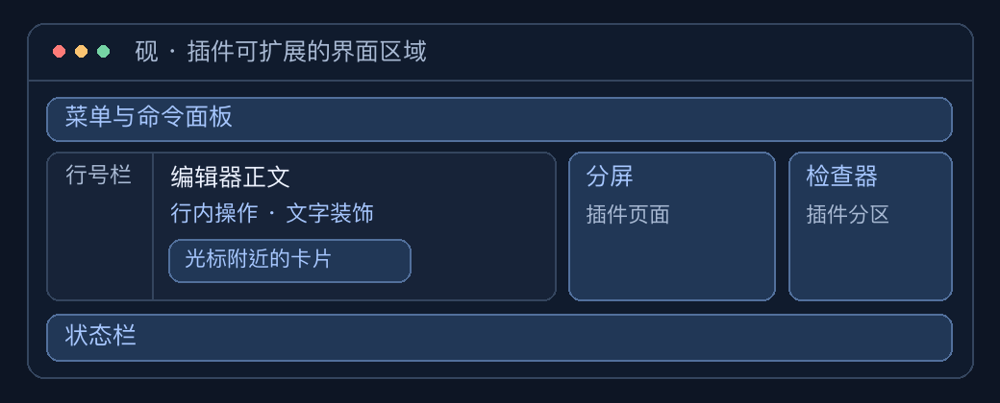
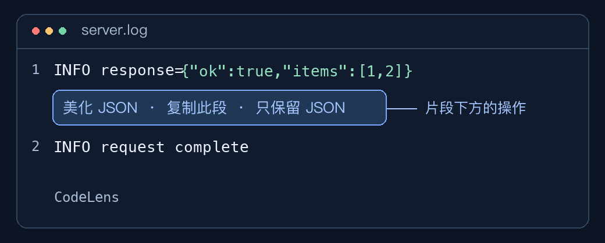
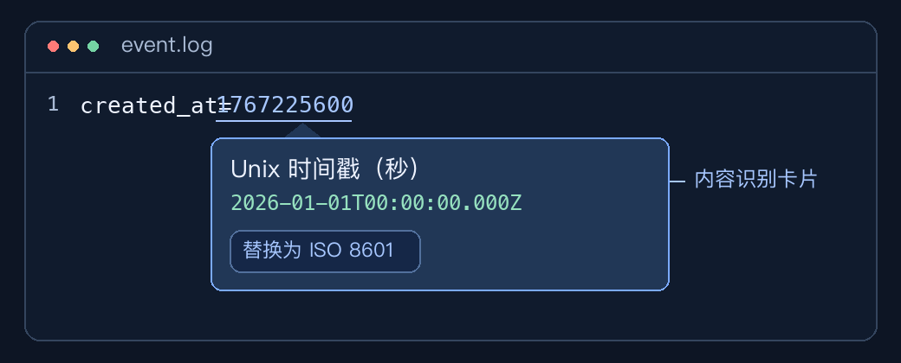
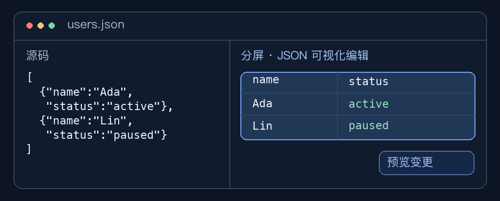

# 插件效果示例

[插件开发入口](../plugins.html) · [JavaScript 插件开发手册](plugin-guide.md)

这些图是根据现有示例插件绘制的界面示意。砚 1.0.4 及后续版本支持插件。



## 编辑器行内 · 文本片段助手



**怎么触发**　用纯文本打开日志，输入 `INFO response={"ok":true,"items":[1,2]}`。插件识别内嵌 JSON，在该行下方提供操作。点击「美化 JSON」只替换 JSON 片段，保留日志前缀。

**能控制什么**　`languageFeatures` 的 `codeLens` 可以指定位置、按钮文字、点击执行的命令及其参数。宿主负责文字和按钮的布局。下列返回值将一个操作放到片段所在行的下方。对应的 `format` 命令负责查找并美化片段。

```js
return [{
  line: 1,
  below: true,
  title: "美化 JSON",
  command: "format"
}];
```

[代码透镜的声明与注册](plugin-guide.md#代码透镜-codelens)

## 光标附近 · 时间戳识别卡片



**怎么触发**　用纯文本打开 `created_at=1767225600`，按住 ⌘ 并指向数字。宿主给识别范围加下划线，并在附近显示卡片。点击「替换为 ISO 8601」可以原地替换该范围。

**能控制什么**　`inspect` 提供者返回匹配范围、标题、内容、明细、色块和可用操作。宿主根据指针与窗口位置摆放卡片。

[内容识别的完整时间戳示例](plugin-guide.md#识别内容-inspect)

## 分屏与独立窗口 · JSON 可视化编辑器



**怎么触发**　打开包含非空对象数组的 JSON，例如 `[{"name":"Ada","status":"active"},{"name":"Lin","status":"paused"}]`，点击标签顶部的「分屏」。修改右侧单元格，再用「预览变更」确认并写回。也可以从右键菜单或命令面板运行「可视化编辑 JSON」，打开独立窗口。

**能控制什么**　`panels` 提供自己的 HTML、CSS 和交互逻辑。通过 `customEditors` 绑定语言及内容条件后，同一个页面可以出现在分屏里。插件页面通过编辑器 API 写回内容。

[工具面板](plugin-guide.md#8-工具面板详解) · [自定义编辑器](plugin-guide.md#自定义编辑器-customeditors)

## 界面区域与贡献点

| 界面区域 | 可以提供的内容或操作 | 对应贡献点 |
| --- | --- | --- |
| 编辑器正文与行号栏 | 文本高亮、下划线、行号栏图标和点击动作 | [装饰](plugin-guide.md#装饰) |
| 行上方或下方 | 可点击的提示文字，运行插件命令 | [`codeLens`](plugin-guide.md#代码透镜-codelens) |
| 光标附近 | 内容识别卡片、悬停提示、补全 | [`inspect`](plugin-guide.md#识别内容-inspect)、[悬停与补全](plugin-guide.md#悬停与补全) |
| 编辑器底部 | 状态文字、图标和点击命令 | [`statusItems`](plugin-guide.md#状态栏) |
| 右侧检查器 | 在指定语言的文档中嵌入插件页面 | [`inspectorSections`](plugin-guide.md#检查器分区) |
| 标签页分屏或独立窗口 | 自定义 HTML 界面，例如表格、表单和图表 | [`customEditors`](plugin-guide.md#自定义编辑器-customeditors)、[`panels`](plugin-guide.md#8-工具面板详解) |
| 编辑器右键、工具菜单、命令面板 | 带显示条件的命令入口 | [通用命令](plugin-guide.md#9-通用命令)、[菜单](plugin-guide.md#菜单-menus) |
| 设置与插件中心 | 设置表单、详情及自定义页面 | [插件设置](plugin-guide.md#11-插件设置)、[插件中心](plugin-guide.md#19-插件中心详情页与自定义页面) |

宿主提供编辑器、菜单、状态栏与卡片的整体布局。插件向这些区域提交内容和操作。插件自己的 HTML 页面可以自定义内部布局和交互。
